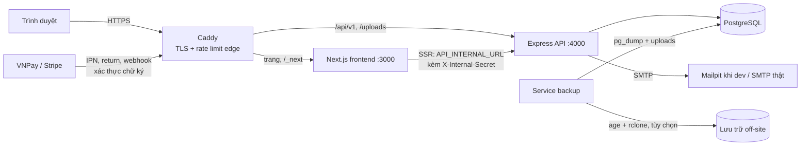
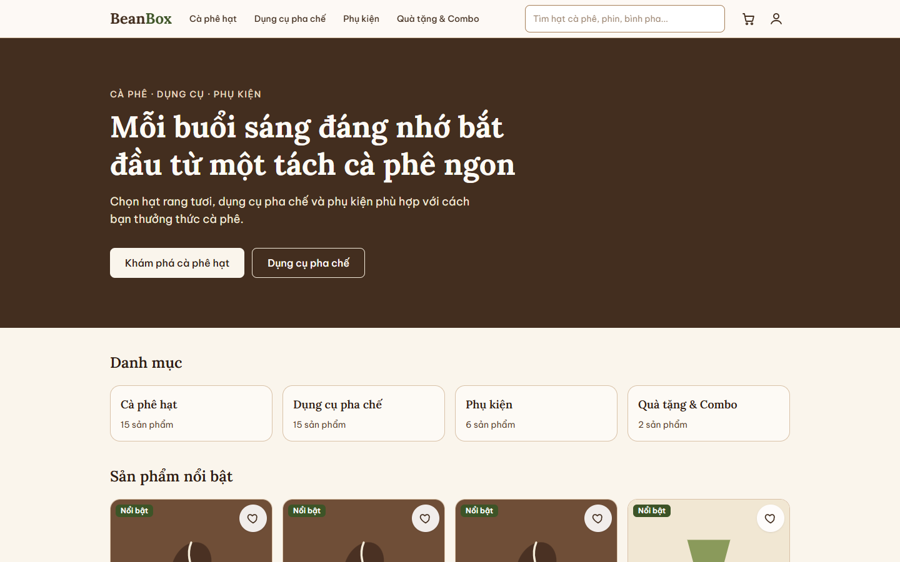
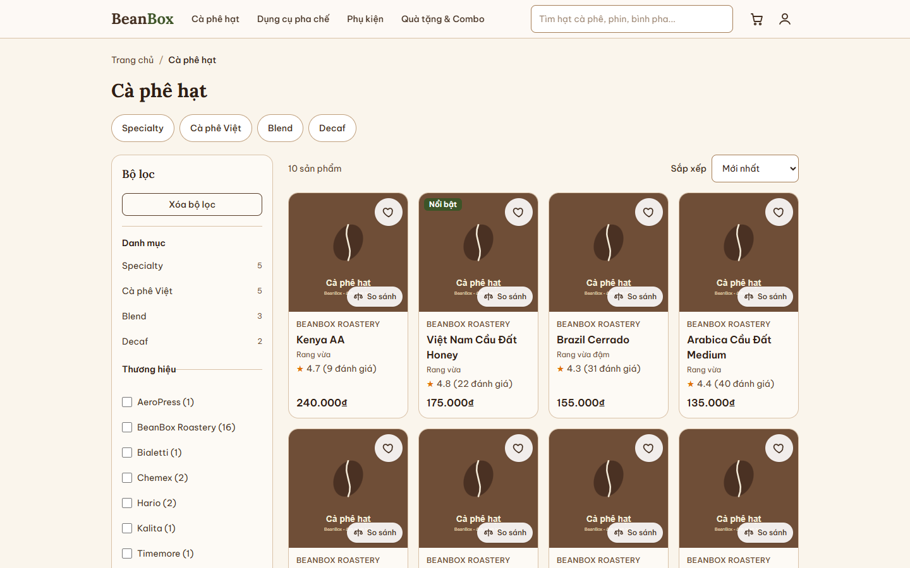
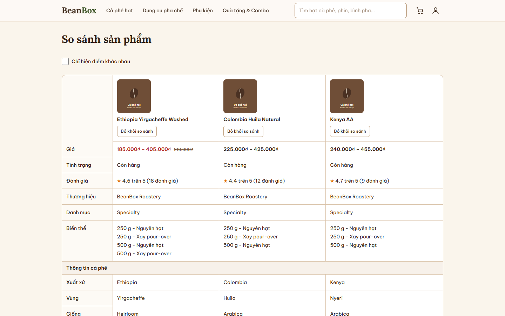
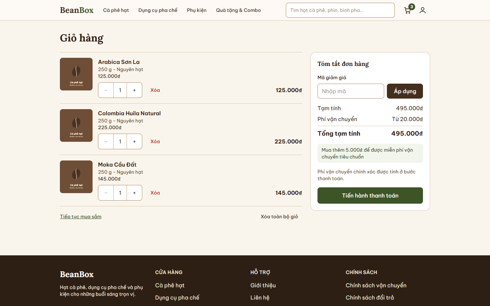
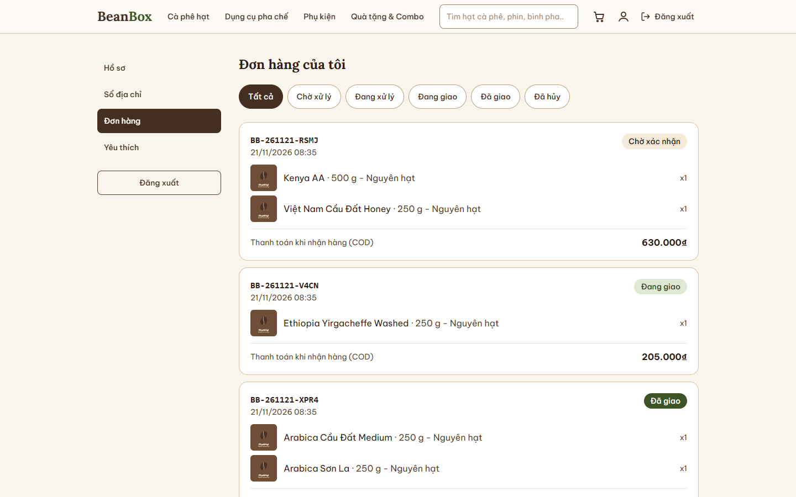
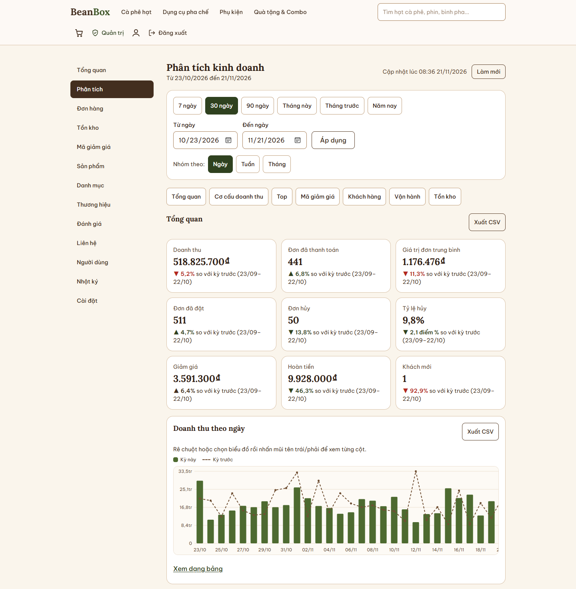
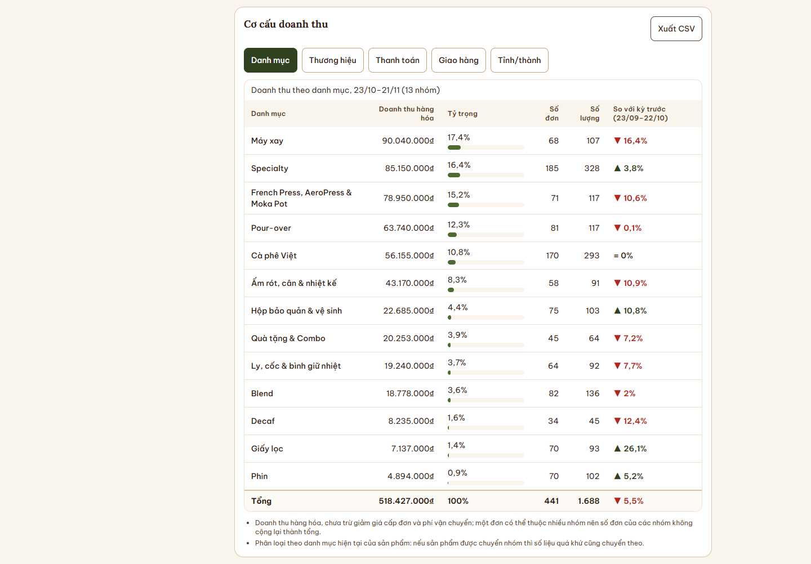
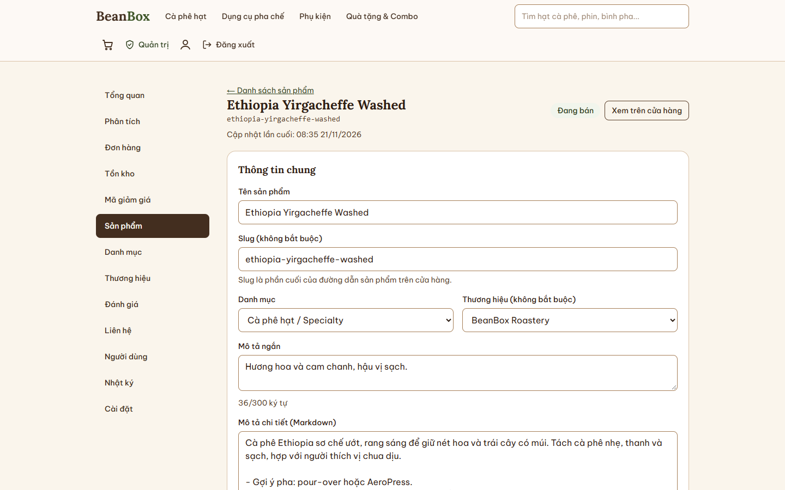
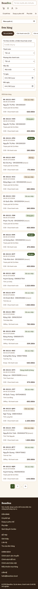

# BeanBox

[](https://github.com/DuongKhang3666/BeanBox/actions/workflows/ci.yml)

BeanBox là web thương mại điện tử bán hạt cà phê, dụng cụ pha chế và phụ kiện. Giao diện tiếng Việt, tiền tệ VND. Dự án full-stack gồm storefront (Next.js), REST API (Express + Prisma + PostgreSQL), trang quản trị, thanh toán sandbox (VNPay, Stripe test mode) và bộ vận hành (Caddy, backup, CI) để chạy được trên một VPS.

## Mục lục

- [Tính năng chính](#tính-năng-chính)
- [Kiến trúc](#kiến-trúc)
- [Stack](#stack)
- [Chạy local](#chạy-local)
- [Kiểm thử và CI](#kiểm-thử-và-ci)
- [Quyết định kỹ thuật nổi bật](#quyết-định-kỹ-thuật-nổi-bật)
- [Ảnh chụp màn hình](#ảnh-chụp-màn-hình)
- [Cấu trúc thư mục](#cấu-trúc-thư-mục)
- [Triển khai](#triển-khai)
- [Tài liệu](#tài-liệu)

## Tính năng chính

### Khách hàng

- Duyệt danh mục, trang chi tiết sản phẩm (biến thể, giá khuyến mãi, tồn kho), lọc, sắp xếp và tìm kiếm không phân biệt dấu tiếng Việt, có gợi ý khi gõ.
- Gợi ý sản phẩm: "Sản phẩm liên quan" chấm điểm theo danh mục, thương hiệu, tag, thông số cà phê và khoảng giá; "Thường được mua cùng" tính từ đơn hàng thật, chỉ hiện khi có ít nhất 2 khách khác nhau đã mua cùng (ngưỡng riêng tư). Dữ liệu demo không có đơn giả nên mục này trống cho tới khi có đơn thật.
- So sánh sản phẩm: chọn 2–4 sản phẩm bằng nút "So sánh" (lưu ở trình duyệt, không cần đăng nhập), xem bảng so sánh giá, biến thể, đánh giá và thông số cà phê (xuất xứ, sơ chế, mức rang, hương vị, cách pha) tại `/so-sanh`; có thể chỉ hiện điểm khác nhau và chia sẻ bằng đường dẫn `?sp=`.
- Giỏ hàng lưu ở server cho cả khách vãng lai (token giỏ) lẫn người đăng nhập; gộp giỏ khi đăng nhập.
- Checkout: mã giảm giá, phí vận chuyển tính theo khu vực, phương thức giao và khối lượng, thanh toán COD, VNPay sandbox hoặc Stripe test mode.
- Khách vãng lai tra cứu và hủy đơn bằng mã đơn + số điện thoại; email xác nhận và email đổi trạng thái đơn.
- Tài khoản: đăng ký, xác thực email, quên/đặt lại mật khẩu, sổ địa chỉ (dữ liệu hành chính 2 cấp), lịch sử đơn hàng, danh sách yêu thích.
- Đánh giá sản phẩm (chỉ người đã nhận hàng), trang chính sách, giới thiệu, form liên hệ (captcha Cloudflare Turnstile tùy chọn).
- SEO: `sitemap.xml`, `robots.txt`, metadata từng trang, redirect slug khi đổi tên sản phẩm.

### Admin / Staff

- Dashboard thống kê, quản lý đơn hàng theo máy trạng thái (xác nhận, giao, hủy, ghi nhận hoàn tiền thủ công).
- Quản lý sản phẩm (biến thể, ảnh, khôi phục), danh mục, thương hiệu, tồn kho kèm lịch sử nhập/xuất, mã giảm giá.
- Duyệt đánh giá (ẩn/hiện, trả lời), hộp thư liên hệ, nhật ký thao tác (audit log).
- Chỉ Admin: cài đặt cửa hàng (phí ship, ngưỡng freeship, thông tin liên hệ...), quản lý người dùng.

**Phân tích kinh doanh (chỉ Admin, `/admin/phan-tich`)**: kế hoạch ở [docs/admin-dashboard-plan.md](docs/admin-dashboard-plan.md), API ở [api-contract §16](docs/api-contract.md).

- KPI (doanh thu, đơn đã thanh toán, giá trị đơn trung bình, tỷ lệ hủy, hoàn tiền, khách mới...) kèm so sánh với kỳ trước; biểu đồ doanh thu theo ngày/tuần/tháng, có bảng thay thế cho trình đọc màn hình.
- Cơ cấu doanh thu theo danh mục, thương hiệu, phương thức thanh toán, giao hàng và tỉnh/thành; top sản phẩm và top khách; khách lần đầu so với quay lại.
- Vận hành: đơn hủy theo loại, đơn trả hàng, thời gian xử lý, đơn cần xử lý. Tồn kho: hết hàng, sắp hết, bán chậm, giá trị tồn.
- Hiệu quả mã giảm giá; xuất CSV (chống CSV injection, ghi audit log, có rate limit); bản in.

### Vận hành

- Triển khai bằng Docker Compose với Caddy (HTTPS tự động, rate limit ở edge), backup hằng ngày, giám sát uptime bằng script.
- Job nền: hủy đơn quá hạn thanh toán, dọn dữ liệu hết hạn.
- CI GitHub Actions: lint, typecheck, test, E2E, quét secret, báo cáo audit, build image.

## Kiến trúc



- Production chỉ Caddy publish cổng ra ngoài. Caddy định tuyến `/api/v1/*` và `/uploads/*` thẳng tới backend, phần còn lại tới Next.js.
- Server Components của Next.js gọi backend qua mạng Docker nội bộ (`API_INTERNAL_URL`) cho dữ liệu công khai, kèm `X-Internal-Secret` để không bị tính chung vào rate limit của backend. Rate limit cho lưu lượng SSR do Caddy đảm nhiệm.
- Ở dev, trình duyệt gọi `/api/v1/*` qua `rewrites` của Next.js tới `localhost:4000`, nên cookie vẫn first-party.
- Sơ đồ đã thu gọn: callback thanh toán đi qua Caddy tới API. Chi tiết: [docs/architecture.md](docs/architecture.md).

## Stack

| Thành phần        | Công nghệ                                                                           | Phiên bản (theo `package.json`) |
| ----------------- | ----------------------------------------------------------------------------------- | ------------------------------- |
| Runtime           | Node.js                                                                             | >= 22                           |
| Frontend          | Next.js (App Router), React                                                         | `^16.4`, `^19.3`                |
| Styling           | Tailwind CSS                                                                        | `^4.3`                          |
| Ngôn ngữ          | TypeScript                                                                          | backend `~5.9`, frontend `^6.0` |
| Backend           | Express                                                                             | `^4.22`                         |
| Validate          | Zod                                                                                 | `^4.6`                          |
| ORM               | Prisma (driver adapter `pg`)                                                        | `~7.10`                         |
| Database          | PostgreSQL                                                                          | 17 (image Docker)               |
| Auth              | argon2 (argon2id), jose (JWT)                                                       | `^0.45`, `^6.2`                 |
| Log, bảo mật HTTP | pino, helmet, express-rate-limit                                                    | `^10.4`, `^8.3`, `^8.7`         |
| Test              | Vitest + supertest (backend), Vitest + Testing Library (frontend), Playwright (E2E) | `^5.1`, `^5.1`, `^1.65`         |
| Hạ tầng           | Docker Compose, Caddy, GitHub Actions                                               |                                 |

## Chạy local

Yêu cầu: Node.js >= 22 với npm, Docker và Docker Compose.

```bash
# 1. Hạ tầng: PostgreSQL (127.0.0.1:5432, tự tạo thêm DB beanbox_test)
#    và Mailpit (SMTP 1025, giao diện http://localhost:8025)
docker compose up -d db mailpit

# 2. Backend
cd backend
cp .env.example .env          # PowerShell: Copy-Item .env.example .env
npm install
npm run prisma:generate       # Prisma 7 bắt buộc (D-036): sinh client vào src/generated, không commit
npm run prisma:deploy         # áp migration (hoặc npm run prisma:migrate khi phát triển schema)
npm run prisma:seed           # tài khoản, danh mục, sản phẩm, cài đặt, mã giảm giá mẫu
npm run dev                   # http://localhost:4000/api/v1/health

# 3. Frontend (terminal khác)
cd frontend
cp .env.example .env.local    # PowerShell: Copy-Item .env.example .env.local
npm install
npm run dev                   # http://localhost:3000
```

Phải chạy lại `npm run prisma:generate` sau mỗi lần `npm install`/`npm ci` hoặc khi sửa `schema.prisma`.

Tùy chọn: chạy cả backend và frontend trong Docker bằng profile `app`. Cần `JWT_ACCESS_SECRET` và `INTERNAL_API_SECRET` (mỗi biến >= 32 ký tự, tự đặt) trong `.env` ở thư mục gốc hoặc môi trường shell.

```bash
docker compose --profile app up -d --build
# Frontend http://localhost:3000, backend http://localhost:4000/api/v1/health
```

### Tài khoản demo (từ seed)

| Email                    | Vai trò    |
| ------------------------ | ---------- |
| `admin@beanbox.local`    | Admin      |
| `staff@beanbox.local`    | Staff      |
| `customer@beanbox.local` | Khách hàng |

Mật khẩu lấy từ các biến `SEED_ADMIN_PASSWORD`, `SEED_STAFF_PASSWORD`, `SEED_CUSTOMER_PASSWORD` trong `backend/.env` (giá trị dev mặc định nằm trong [backend/.env.example](backend/.env.example), chỉ dùng cho môi trường dev). Seed từ chối chạy khi `NODE_ENV=production`, trừ khi đặt `SEED_ALLOW_PRODUCTION=true` có chủ ý (xem [docs/deployment.md](docs/deployment.md)).

Reset DB dev (xóa sạch dữ liệu, migrate lại và seed lại): `npm run db:reset` trong `backend/`.

## Kiểm thử và CI

```bash
# Backend (cần Postgres đang chạy; test dùng DB riêng beanbox_test, tự áp migration)
cd backend
npm run lint && npm run typecheck && npm test && npm run build

# Frontend
cd frontend
npm run lint && npm run typecheck && npm test && npm run build

# E2E (Playwright, chromium)
cd frontend
npx playwright install chromium    # một lần
npm run test:e2e
```

- Test backend gồm unit (tính giá, phí ship, máy trạng thái...) và integration bằng supertest trên Postgres thật, trong đó có ma trận phân quyền tự động cho các route (`backend/tests/securityAuthz.integration.test.ts`).
- Nếu volume Postgres có từ trước nên chưa có DB `beanbox_test`: `docker compose exec db psql -U beanbox -c "CREATE DATABASE beanbox_test"`.
- E2E cần Postgres đã migrate và seed, và `backend/.env` có các biến `SEED_*` (config tự đọc mật khẩu từ đó). Playwright tự khởi động backend và frontend. Lưu ý giới hạn đăng nhập 5 lần/phút/IP khi chạy lặp liên tiếp. Chi tiết: [docs/testing.md](docs/testing.md).

Workflow `.github/workflows/ci.yml` (chạy khi push lên `main` và trên pull request):

| Job           | Nội dung                                                                                                                           |
| ------------- | ---------------------------------------------------------------------------------------------------------------------------------- |
| `backend`     | Postgres service, `prisma migrate deploy` trên DB trống, kiểm drift migration so với `schema.prisma`, lint, typecheck, test, build |
| `frontend`    | lint, typecheck, test, build                                                                                                       |
| `e2e`         | Playwright (chromium) với Postgres + Mailpit, seed bằng mật khẩu giả của CI; chạy sau `backend` và `frontend`                      |
| `secret-scan` | gitleaks (Docker, ghim phiên bản) quét toàn bộ lịch sử git                                                                         |
| `audit`       | `npm audit` cả hai phía, chỉ báo cáo, không làm fail                                                                               |
| `docker`      | Build image backend, frontend, Caddy; build image backup và chạy selftest backup off-site (không push)                             |
| `ops-lint`    | `shellcheck` cho script trong `deploy/`, `docker compose config` cho file compose production                                       |

Không có deploy tự động.

## Quyết định kỹ thuật nổi bật

Danh sách đầy đủ ở [docs/decisions.md](docs/decisions.md).

**Xác thực và phân quyền** ([kiến trúc, mục 4](docs/architecture.md#4-xác-thực--phiên))

- Mật khẩu băm argon2id. Access token là JWT 15 phút (HS256) giữ trong bộ nhớ trình duyệt, không đặt vào localStorage.
- Refresh token là chuỗi ngẫu nhiên (không phải JWT), DB chỉ lưu SHA-256; cookie `bb_rt` httpOnly, `SameSite=Strict`, giới hạn `Path`. Mỗi lần refresh là một lần rotation; dùng lại token đã thu hồi sẽ thu hồi cả chuỗi phiên.
- Endpoint dùng cookie kiểm thêm header `Origin` theo whitelist (chống CSRF). Khóa tạm tài khoản sau nhiều lần đăng nhập sai, rate limit riêng cho đăng nhập.
- Ba vai trò `CUSTOMER`, `STAFF`, `ADMIN`; role và trạng thái user được đọc lại từ DB ở mỗi request đã xác thực. Đơn của khách đăng nhập chỉ truy cập được khi `order.userId` khớp người gọi (ngược lại trả 404); đơn khách vãng lai cần mã đơn + SĐT ([D-005](docs/decisions.md#d-005-khách-vãng-lai-xem-đơn-qua-trang-tra-cứu)).

**Tiền và giá** ([D-003](docs/decisions.md#d-003-phụ-phí-khối-lượng-và-freeship), [kiến trúc, mục 5](docs/architecture.md#5-giỏ-hàng-giá-đơn-hàng))

- Mọi số tiền là `Int` VND ở schema Prisma và API, không dùng float. Checkout không nhận giá từ client: server tính lại giá hiệu lực, mã giảm giá, phí ship và phụ phí khối lượng từ giỏ hàng.

**Phân tích kinh doanh** ([D-019](docs/decisions.md#d-019-dashboard-và-audit-log), [D-049](docs/decisions.md#d-049-khu-phân-tích-kinh-doanh-chỉ-admin), [D-053](docs/decisions.md#d-053-hiệu-quả-mã-giảm-giá-và-xuất-csv-bước-4), [D-054](docs/decisions.md#d-054-hiệu-năng-a11y-và-bản-in-khu-phân-tích-bước-5-phần-a))

- Doanh thu tính theo `paidAt` và chỉ gồm đơn đã thanh toán, chưa hủy hoặc hoàn trả; đơn đã đặt tính theo ngày tạo. Phân quyền hai lớp: router `/admin/analytics/*` gắn `requireAdmin` ở backend (STAFF nhận 403) và FE ẩn khu này với STAFF.
- Xuất CSV có BOM, chống CSV injection theo kiểu ô, ghi audit trước khi gửi dữ liệu. Hiệu năng đo trên 100.000 đơn sinh bằng `backend/scripts/generate-demo-orders.ts` (chỉ chạy trên DB tạm); kết quả trước/sau ở [docs/testing.md](docs/testing.md).

**Idempotency khi tạo đơn** ([kiến trúc, mục 5](docs/architecture.md#5-giỏ-hàng-giá-đơn-hàng))

- `POST /orders` bắt buộc header `Idempotency-Key` (UUID v4). `Order.idempotencyKey` là unique và đơn lưu thêm fingerprint của payload: gửi lại cùng key và cùng payload trả lại đơn cũ, cùng key khác payload trả 409.

**Tồn kho và mã giảm giá** ([D-004](docs/decisions.md#d-004-giữ-lượt-mã-giảm-giá-khi-tạo-đơn))

- Kho được giữ ngay khi tạo đơn, trong một transaction: `UPDATE ... SET stock = stock - n WHERE stock >= n` (0 dòng bị ảnh hưởng thì rollback `OUT_OF_STOCK`), khóa các variant theo thứ tự id để tránh deadlock, ghi `InventoryMovement`. Hủy hoặc hết hạn thanh toán thì hoàn kho. Lượt mã giảm giá cũng được giữ bằng UPDATE có điều kiện và hoàn lại khi hủy.

**Thanh toán** ([D-014](docs/decisions.md#d-014-thanh-toán-online-m5), [D-015](docs/decisions.md#d-015-hoàn-tiền-thủ-công-và-job-hết-hạn), [cấu hình sandbox](docs/payments-setup.md))

- Chỉ VNPay sandbox và Stripe test mode (khóa `sk_live_` bị backend từ chối khởi động). Không dùng SDK: VNPay tự ký HMAC-SHA512, Stripe gọi REST.
- Chỉ dữ liệu có chữ ký (IPN/return VNPay, webhook Stripe có chống replay) hoặc truy vấn server-to-server mới chuyển đơn sang đã thanh toán; mọi nguồn đi qua một hàm xử lý idempotent trong một transaction. Đơn chờ thanh toán có hạn (mặc định 15 phút) và job nền hủy khi quá hạn. Hoàn tiền là thủ công, có ghi nhận và audit log.

**CSP** ([D-040](docs/decisions.md#d-040-csp-ở-m8))

- CSP được thực thi (không còn report-only). Trang `/admin` dùng nonce theo request cùng `'strict-dynamic'`. Storefront vẫn phải giữ `'unsafe-inline'` trong `script-src` để giữ static/ISR (nonce toàn site buộc mọi trang render động; hash không khả thi vì script inline của Next đổi theo trang/build). Đánh đổi: CSP của storefront chưa chặn được XSS inline; các chỉ thị còn lại (`frame-ancestors 'none'`, `object-src 'none'`, `base-uri`, `form-action`, `connect-src 'self'`) vẫn có hiệu lực.

**Backup** ([D-034](docs/decisions.md#d-034-backup-và-khôi-phục), [D-038](docs/decisions.md#d-038-backup-off-site))

- `pg_dump` và uploads hằng ngày, xoay vòng cục bộ. Off-site tùy chọn (mặc định tắt): mã hóa age bằng public key (VPS không giữ private key), đẩy bằng rclone, tạo và kiểm `SHA256SUMS`, xoay vòng bản trên remote, có `selftest-offsite.sh` kiểm cả luồng. Rclone ghim phiên bản chính thức, kiểm SHA-256 lúc build ([D-041](docs/decisions.md#d-041-ghim-rclone-trong-image-backup)); `backup.sh` giữ khóa `flock` để hai lần backup không chạy chồng, lần sau thoát mã 5 và bỏ qua ([D-042](docs/decisions.md#d-042-khóa-chống-hai-backup-chạy-chồng)); CI chạy selftest off-site với Postgres thật ([D-043](docs/decisions.md#d-043-selftest-backup-trong-ci)).

**Khác**

- Rate limit hai tầng: Caddy ở edge (theo IP, kể cả lưu lượng SSR) và `express-rate-limit` ở app theo nhóm endpoint ([D-009](docs/decisions.md#d-009-xác-định-ip-client-cho-rate-limit), [D-026](docs/decisions.md#d-026-reverse-proxy-caddy-và-rate-limit-ở-edge)). Bộ đếm nằm trong bộ nhớ nên hiện chỉ phù hợp một instance ([D-027](docs/decisions.md#d-027-rate-limit-khi-nhiều-instance)).
- Backend validate toàn bộ env bằng Zod khi khởi động và kiểm lại trước `migrate deploy` ([D-037](docs/decisions.md#d-037-kiểm-env-trước-migrate-và-redirect-cổng-caddy)).
- Quét secret bằng gitleaks trong CI ([D-033](docs/decisions.md#d-033-ci-github-actions)); giám sát uptime bằng `deploy/monitoring/check.sh` ([D-039](docs/decisions.md#d-039-giám-sát-uptime)).

## Ảnh chụp màn hình

Ảnh chụp từ bản production chạy với dữ liệu demo (đơn hàng sinh ngẫu nhiên có seed cố định, không phải số liệu thật). Chụp lại bằng script: xem [`docs/screenshots/README.md`](docs/screenshots/README.md).

**Trang chủ**



**Danh sách sản phẩm có bộ lọc**



**Chi tiết sản phẩm**


**So sánh sản phẩm**



**Giỏ hàng**



**Thanh toán**


**Tra cứu đơn của khách vãng lai**


**Đơn hàng của tôi**



**Phân tích kinh doanh (chỉ Admin)**





**Dashboard quản trị**


**Quản lý đơn hàng**


**Sửa sản phẩm**



**Trang chủ trên mobile**


**Quản lý đơn hàng trên mobile**



## Cấu trúc thư mục

```
BeanBox/
├─ backend/                 Express API
│  ├─ src/                  config, lib, middlewares, modules/<module>, jobs
│  ├─ prisma/               schema.prisma, migrations, seed
│  ├─ prisma.config.ts      cấu hình Prisma CLI (Prisma 7)
│  └─ tests/                unit + integration
├─ frontend/                Next.js (App Router)
│  ├─ src/app/              route (/san-pham, /gio-hang, /admin ...)
│  ├─ src/components/       UI dùng chung
│  └─ e2e/                  Playwright
├─ deploy/
│  ├─ caddy/                Caddyfile, Dockerfile (plugin rate limit)
│  ├─ backup/               backup, restore, off-site, selftest
│  └─ monitoring/           check.sh
├─ docker/db-init/          khởi tạo DB test cho docker compose
├─ docs/                    tài liệu thiết kế, kiểm thử, triển khai
├─ docker-compose.yml       dev: db, mailpit; profile app
├─ docker-compose.prod.yml  production/demo: caddy, frontend, backend, db; profile backup, tools
├─ .env.production.example  mẫu biến môi trường production
└─ .github/workflows/ci.yml
```

## Triển khai

Demo chạy trên một VPS bằng `docker-compose.prod.yml`: Caddy làm reverse proxy với HTTPS tự động, chỉ Caddy publish cổng; backend, frontend, PostgreSQL nằm trong mạng Docker nội bộ. Biến môi trường lấy từ `.env.production` (mẫu: `.env.production.example`). Hướng dẫn VPS, DNS, thanh toán sandbox, backup/restore, rollback và checklist go-live: [docs/deployment.md](docs/deployment.md).

## Tài liệu

- [Yêu cầu](docs/requirements.md)
- [Kiến trúc](docs/architecture.md)
- [Nhật ký quyết định](docs/decisions.md)
- [API contract](docs/api-contract.md) (nguồn sự thật cho FE và BE)
- [Thiết kế DB](docs/db-schema.md)
- [Kế hoạch khu Phân tích kinh doanh (Admin)](docs/admin-dashboard-plan.md)
- [Kiểm thử](docs/testing.md)
- [Triển khai](docs/deployment.md)
- [Cấu hình thanh toán sandbox](docs/payments-setup.md)
