# BeanBox

[](https://github.com/DuongKhang3666/BeanBox/actions/workflows/ci.yml)

BeanBox là web thương mại điện tử bán hạt cà phê, dụng cụ pha chế và phụ kiện, giao diện tiếng Việt, tiền tệ VND. Đây là dự án portfolio full-stack (Next.js, Express, Prisma, PostgreSQL) chạy trên localhost: clone về và chạy bằng một lệnh Docker là có site, dữ liệu mẫu và tài khoản demo.

Mọi thanh toán và vận chuyển trong bản demo đều là giả lập (cổng VNPay/MoMo giả, chuyển khoản VietQR demo, mã vận đơn và hành trình mô phỏng), không có tiền thật và không gọi dịch vụ ngoài. Phần lõi (giá, tồn kho, thanh toán, phiên đăng nhập) vẫn đi qua đúng logic như khi dùng nhà cung cấp thật; xem [tổng quan quyết định kỹ thuật](docs/overview.md).

## Mục lục

- [Chạy demo bằng một lệnh](#chạy-demo-bằng-một-lệnh)
- [Kịch bản demo 5 phút](#kịch-bản-demo-5-phút)
- [Tour tính năng](#tour-tính-năng)
- [Điểm kỹ thuật nổi bật](#điểm-kỹ-thuật-nổi-bật)
- [Kiến trúc](#kiến-trúc)
- [Stack](#stack)
- [Chạy từng phần để phát triển](#chạy-từng-phần-để-phát-triển)
- [Kiểm thử và CI](#kiểm-thử-và-ci)
- [Cấu trúc thư mục](#cấu-trúc-thư-mục)
- [Triển khai](#triển-khai)
- [Tài liệu](#tài-liệu)

## Chạy demo bằng một lệnh

Chỉ cần Docker (Compose v2), không cần cài Node hay Postgres. Lệnh dưới dựng sẵn DB, migrate, seed, khoảng 1.500 đơn demo trong 90 ngày, backend, frontend và một Mailpit riêng (D-066).

```bash
docker compose -f docker-compose.demo.yml up --build     # PowerShell và Git Bash giống nhau
```

- Web: <http://localhost:3300> (khu quản trị: `/admin`). Email đặt hàng/hủy xem ở Mailpit: <http://localhost:8026>.
- Tài khoản demo (mật khẩu công khai, chỉ dùng cho demo local):

  | Vai trò    | Email                    | Mật khẩu                  |
  | ---------- | ------------------------ | ------------------------- |
  | Admin      | `admin@beanbox.local`    | `Demo-only-Admin-2026`    |
  | Staff      | `staff@beanbox.local`    | `Demo-only-Staff-2026`    |
  | Khách hàng | `customer@beanbox.local` | `Demo-only-Customer-2026` |

- Dừng và xóa sạch dữ liệu demo: `docker compose -f docker-compose.demo.yml down -v` (thêm `--rmi local` nếu muốn xóa cả image đã build). Chỉ `Ctrl+C` hoặc `down` (không `-v`) thì dữ liệu giữ lại và lần `up` sau không sinh thêm đơn.
- Cổng host dùng: 3300 và 8026 (bind 127.0.0.1); không đụng môi trường dev (3000/4000/5432/8025).
- Thời gian và RAM (đo trên máy dev): lần đầu khoảng 5 phút (build không cache khoảng 4 phút 40 giây, chưa tính tải image nền), các lần sau khoảng 20 giây nhờ cache build. Cần khoảng 2 GB RAM trống khi build; lúc chạy 4 container dùng khoảng 320 MB.

## Kịch bản demo 5 phút

Mở <http://localhost:3300> sau khi chạy demo. Mỗi bước ghi tài khoản dùng; "khách" là chưa đăng nhập.

1. **Duyệt và so sánh (khách).** Vào "Cà phê hạt" (`/danh-muc/ca-phe-hat`), lọc theo mức rang hoặc xuất xứ, bấm "So sánh" ở 2-3 sản phẩm rồi mở `/so-sanh` để xem bảng thông số.
2. **Thanh toán VNPay giả (khách).** Ở trang sản phẩm bấm "Thêm vào giỏ", vào `/gio-hang` chọn "Tiến hành thanh toán", điền thông tin giao hàng (dữ liệu giả, ví dụ SĐT `0912345678`), chọn VNPay (có nhãn "Giả lập, không trừ tiền thật"), tích đồng ý điều khoản, bấm "Đặt hàng". Ở trang cổng giả bấm "Thanh toán thành công" để về trang "Thanh toán thành công". Thử thêm "Thanh toán thất bại" hoặc "Hủy giao dịch" ở một đơn khác để xem đơn vẫn chờ thanh toán.
3. **Chuyển khoản có QR (khách).** Đặt đơn khác, chọn "Chuyển khoản". Trang đặt hàng thành công hiện mã QR VietQR kèm cảnh báo "KHÔNG chuyển tiền thật"; bấm "Tôi đã chuyển khoản". Đơn vẫn "Chờ thanh toán" vì chỉ nhân viên mới xác nhận được. Ghi lại mã đơn và SĐT đã nhập.
4. **Nhân viên xử lý (staff).** Đăng nhập `staff@beanbox.local`, vào `/admin/don-hang`, chọn bộ lọc "Khách báo đã chuyển khoản", mở đơn và bấm "Xác nhận đã nhận tiền" (xác nhận lần hai). Sau đó bấm "Bắt đầu đóng gói", rồi "Giao cho vận chuyển" và để trống ô mã vận đơn: hệ thống tự sinh mã giả dạng `BBL-YYYYMMDD-XXXXXX`.
5. **Tra cứu đơn (khách).** Mở `/tra-cuu-don-hang`, nhập mã đơn và SĐT ở bước 3. Trang hiện dự kiến giao và khối "Hành trình vận chuyển (mô phỏng)": mốc "Đã bàn giao cho đơn vị vận chuyển" có ngay, các mốc sau xuất hiện theo giờ thật (lấy hàng sau 2 giờ, v.v.).
6. **Phân tích và xuất CSV (admin).** Đăng nhập `admin@beanbox.local`, vào `/admin/phan-tich`: KPI so với kỳ trước, biểu đồ doanh thu, cơ cấu theo danh mục/thanh toán/tỉnh; bấm "Xuất CSV" ở một khối để tải file (ghi vào nhật ký tại `/admin/nhat-ky`).
7. **Xác thực 2 lớp (staff).** Đăng nhập staff, vào `/tai-khoan`, mục "Xác thực 2 lớp": "Bật xác thực 2 lớp", nhập mật khẩu, quét QR bằng ứng dụng xác thực (Google/Microsoft Authenticator...) hoặc nhập khóa bằng tay, nhập mã 6 số, lưu 10 mã dự phòng. Đăng xuất rồi đăng nhập lại: sau mật khẩu sẽ có bước "Xác thực 2 lớp". Muốn trở lại như cũ: tắt trong cùng mục, hoặc admin đặt lại ở `/admin/nguoi-dung`.
8. **Dữ liệu cá nhân (khách).** Đăng ký một tài khoản mới (để không xóa tài khoản demo), vào `/tai-khoan`, mục "Dữ liệu cá nhân": "Tải dữ liệu của tôi (JSON)" và "Xóa tài khoản" (nhập mật khẩu và cụm `XOA TAI KHOAN`; bị chặn khi còn đơn đang xử lý). Tài khoản bị ẩn danh hóa, đơn cũ vẫn được giữ để đối soát.
9. **Email (Mailpit).** Mở <http://localhost:8026> để xem email xác nhận đơn và email đổi trạng thái của các bước trên.

## Tour tính năng

### Khách hàng

- Danh mục, chi tiết sản phẩm (biến thể, giá khuyến mãi, tồn kho), lọc, sắp xếp, tìm kiếm không phân biệt dấu tiếng Việt kèm gợi ý khi gõ.
- Gợi ý "Sản phẩm liên quan" (chấm điểm theo danh mục, thương hiệu, tag, thông số, giá) và "Thường được mua cùng" (từ đơn thật, chỉ hiện khi có ít nhất 2 khách khác nhau mua cùng; demo một lệnh sinh sẵn 1.500 đơn nên mục này có dữ liệu ở trang sản phẩm, còn môi trường dev chỉ seed sạch thì trống cho tới khi có đơn).
- So sánh 2-4 sản phẩm (lưu ở trình duyệt, chia sẻ bằng `?sp=`), giỏ hàng lưu ở server cho cả khách vãng lai, mã giảm giá, phí ship theo khu vực và khối lượng.
- Đánh giá (chỉ người đã nhận hàng), trang chính sách, giới thiệu, liên hệ (captcha Turnstile tùy chọn). SEO: sitemap có `lastmod`, canonical/noindex, ảnh Open Graph tự sinh, JSON-LD, trang chủ ISR 60 giây.

| Danh mục có bộ lọc                                                               | So sánh sản phẩm                                          |
| -------------------------------------------------------------------------------- | --------------------------------------------------------- |
|  |  |

| Chi tiết sản phẩm                                                           | Trang chủ trên điện thoại                                      |
| --------------------------------------------------------------------------- | -------------------------------------------------------------- |
| 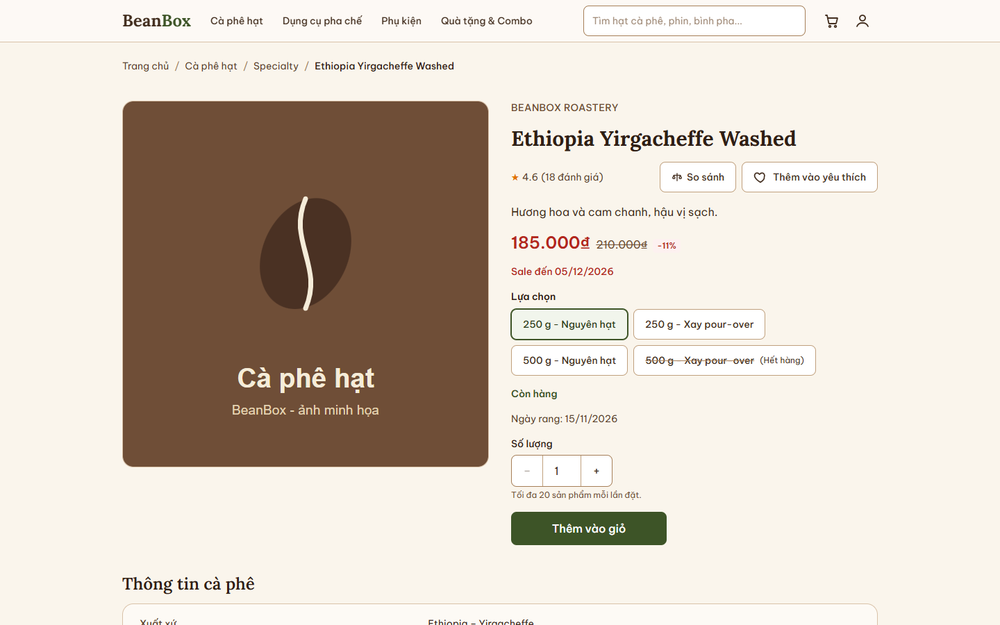 | 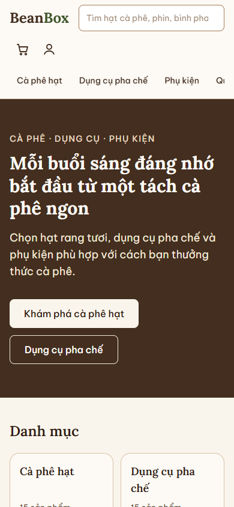 |


### Thanh toán và vận chuyển (giả lập)

- Checkout: COD, VNPay sandbox hoặc Stripe test mode khi có khóa; bật `PAYMENT_MOCKS_ENABLED` và `BANK_TRANSFER_ENABLED` (đã bật sẵn trong demo một lệnh, xem [docs/payments-setup.md](docs/payments-setup.md)) để có VNPay/MoMo giả và chuyển khoản VietQR.
- Cổng giả đi qua đúng hàm xử lý IPN có chữ ký như cổng thật; chuyển khoản chỉ thành "đã thanh toán" khi nhân viên xác nhận.
- Giao hàng giả lập: ngày giao dự kiến theo vùng và phương thức, mã vận đơn giả, hành trình mô phỏng tính từ lịch sử đơn (nhãn "giả lập" luôn hiện).
- Khách vãng lai tra cứu và hủy đơn bằng mã đơn + SĐT.

| Cổng VNPay giả lập                                                                                     | Chuyển khoản VietQR demo                                                                                  |
| ------------------------------------------------------------------------------------------------------ | --------------------------------------------------------------------------------------------------------- |
| 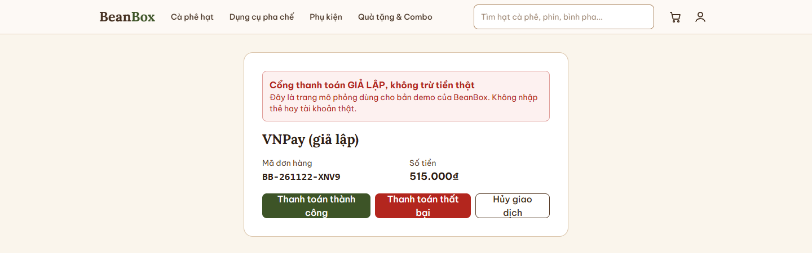 | 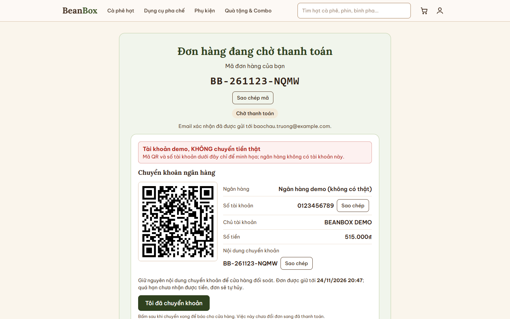 |

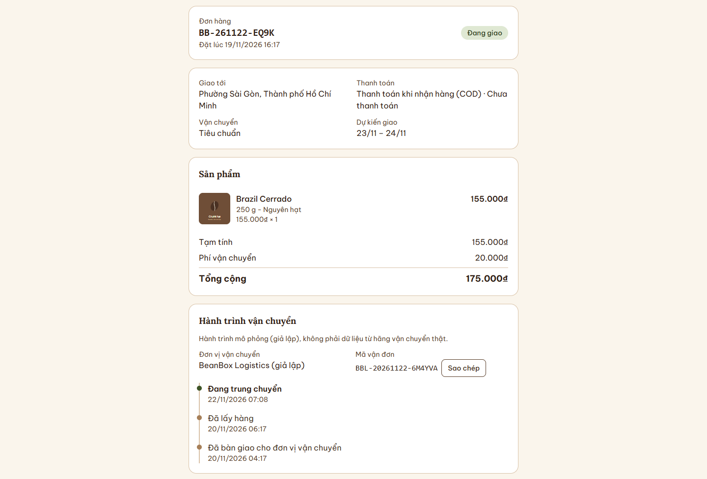

| Giỏ hàng                                              | Thanh toán                                                             |
| ----------------------------------------------------- | ---------------------------------------------------------------------- |
|  | 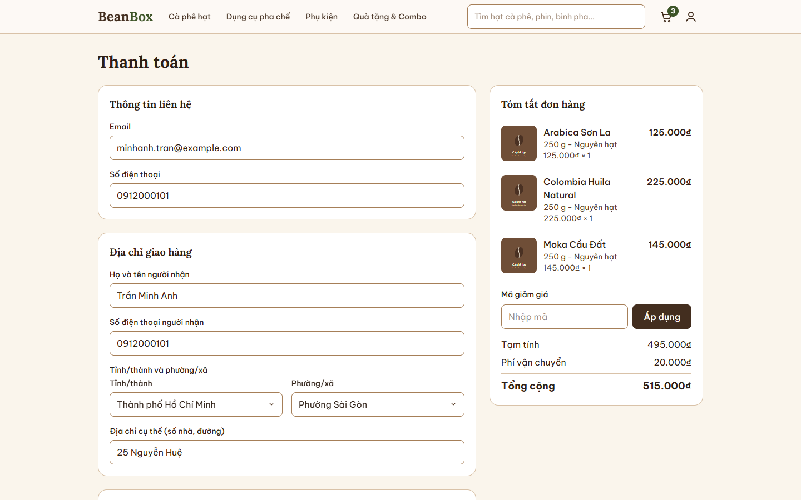 |

### Tài khoản và bảo mật

- Đăng ký, xác thực email, quên/đặt lại mật khẩu, sổ địa chỉ (dữ liệu hành chính 2 cấp), lịch sử đơn, yêu thích.
- Xác thực 2 lớp (TOTP) tùy chọn cho Staff/Admin: QR, 10 mã dự phòng, đăng nhập 2 bước; Admin đặt lại 2FA của người khác; cờ `REQUIRE_ADMIN_2FA` (mặc định tắt) để bắt buộc với Admin.
- Dữ liệu cá nhân: khách tải bản sao dữ liệu (JSON) và tự xóa tài khoản (ẩn danh hóa, giữ đơn để đối soát).

| Đăng nhập bước 2 (mã 2 lớp)                                                  | Bảo mật tài khoản và dữ liệu cá nhân                                                       |
| ---------------------------------------------------------------------------- | ------------------------------------------------------------------------------------------ |
| 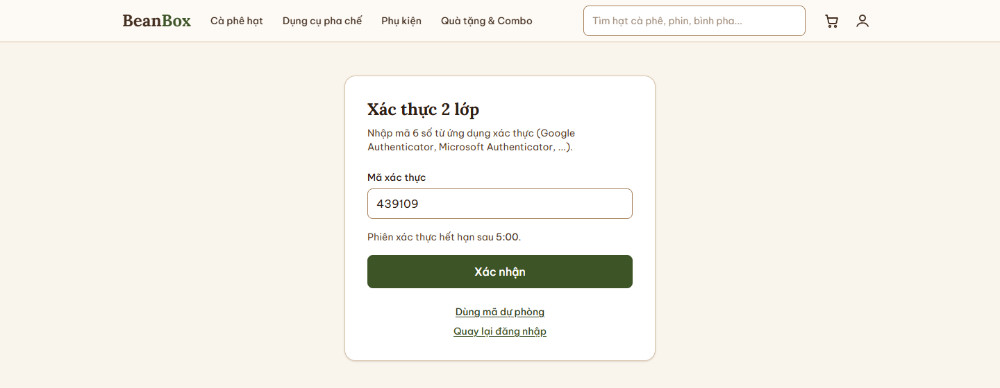 | 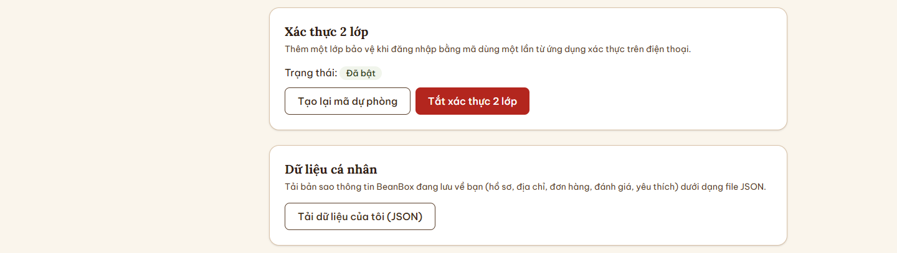 |

| Đơn hàng của tôi                                                                 | Tra cứu đơn khách vãng lai                                                             |
| -------------------------------------------------------------------------------- | -------------------------------------------------------------------------------------- |
|  | 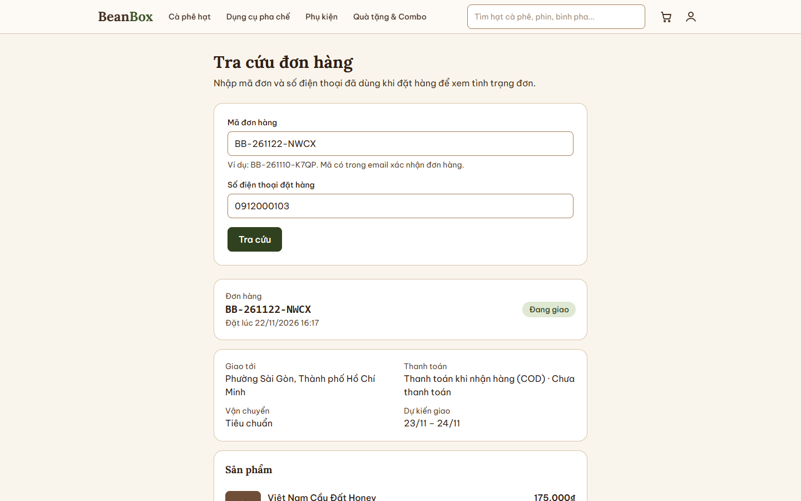 |

### Quản trị và phân tích

- Dashboard, quản lý đơn theo máy trạng thái (xác nhận, giao, hủy, ghi nhận hoàn tiền thủ công, xác nhận chuyển khoản), sản phẩm/biến thể/ảnh, danh mục, thương hiệu, tồn kho kèm lịch sử, mã giảm giá, đánh giá, liên hệ, nhật ký thao tác, cài đặt cửa hàng, quản lý người dùng.
- Công cụ vận hành (D-071..D-073): ghi chú nội bộ trên đơn (khách không thấy), chọn nhiều đơn để in phiếu giao hàng loạt, xuất/nhập CSV sản phẩm (xem trước từng dòng, áp dụng trong một transaction, không bao giờ đổi slug/SKU).
- Nhóm 3 Đợt 4 (D-075..D-077): cache HTTP ngắn cho catalog và ảnh bất biến, khóa tạm theo mã đơn khi khách vãng lai nhập sai SĐT 5 lần, nút "Mua lại" ở chi tiết đơn.
- Giá vốn và lợi nhuận gộp (D-078): nhập hàng kèm đơn giá tính giá vốn bình quân gia quyền di động theo biến thể, chụp vào dòng đơn lúc đặt, `/admin/phan-tich` có lợi nhuận gộp, biên và độ phủ giá vốn (chỉ Admin; đơn cũ chưa có giá vốn).
- Phân tích kinh doanh (chỉ Admin, `/admin/phan-tich`; kế hoạch ở [docs/admin-dashboard-plan.md](docs/admin-dashboard-plan.md), API ở [api-contract §16](docs/api-contract.md)): KPI so với kỳ trước, doanh thu theo ngày/tuần/tháng (có bảng thay thế cho trình đọc màn hình), cơ cấu theo danh mục, thương hiệu, thanh toán, giao hàng, tỉnh; top sản phẩm, top khách, khách mới/quay lại; vận hành, tồn kho, hiệu quả mã giảm giá; xuất CSV (chống CSV injection, có audit và rate limit) và bản in.

| Phân tích kinh doanh                                                                                              | Cơ cấu doanh thu                                                                  |
| ----------------------------------------------------------------------------------------------------------------- | --------------------------------------------------------------------------------- |
|  |  |

| Dashboard quản trị                                                                               | Sửa sản phẩm                                                              |
| ------------------------------------------------------------------------------------------------ | ------------------------------------------------------------------------- |
| 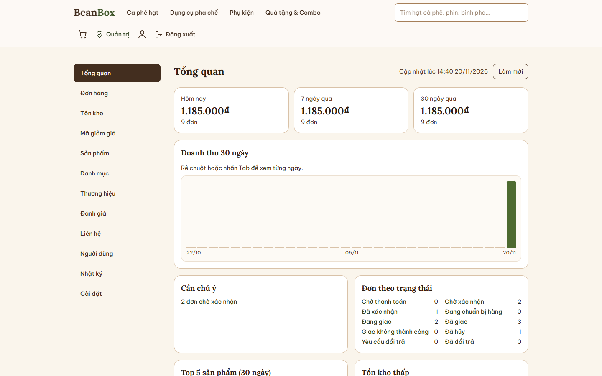 |  |

| Quản lý đơn hàng                                                       | Quản lý đơn hàng trên điện thoại                                                        |
| ---------------------------------------------------------------------- | --------------------------------------------------------------------------------------- |
| 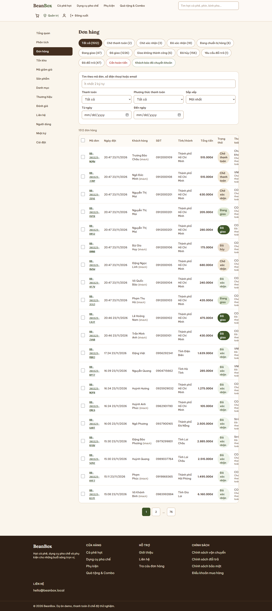 |  |

Ảnh chụp bằng script tái lập được trên DB tạm với dữ liệu demo (đơn sinh ngẫu nhiên có seed cố định, không phải số liệu thật); xem [docs/screenshots/README.md](docs/screenshots/README.md).

### Vận hành

- Docker Compose cho demo (một lệnh), dev và production (Caddy với HTTPS tự động, rate limit ở edge), backup hằng ngày (off-site tùy chọn, mã hóa age), giám sát uptime bằng script.
- Job nền hủy đơn quá hạn thanh toán và dọn dữ liệu hết hạn; gửi email bền vững (thử lại, không chặn đặt hàng).
- CI GitHub Actions 7 job (xem [Kiểm thử và CI](#kiểm-thử-và-ci)); không có deploy tự động.

## Điểm kỹ thuật nổi bật

Bảng tổng hợp quyết định theo chủ đề nằm ở [docs/overview.md](docs/overview.md); danh sách đầy đủ ở [docs/decisions.md](docs/decisions.md).

- **Tiền và giá tính ở server:** mọi số tiền là `Int` VND, checkout không nhận giá từ client mà tính lại giá, mã giảm giá, phí ship và phụ phí khối lượng từ giỏ ([D-003](docs/decisions.md#d-003-phụ-phí-khối-lượng-và-freeship), [kiến trúc, mục 5](docs/architecture.md#5-giỏ-hàng-giá-đơn-hàng)).
- **Idempotency khi đặt đơn:** `POST /orders` bắt buộc `Idempotency-Key`, lưu fingerprint gắn người gọi nên cùng key khác payload hoặc khác người gọi trả 409 ([D-010](docs/decisions.md#d-010-quy-tắc-nghiệp-vụ-checkout-m3)).
- **Giữ tồn kho có điều kiện:** `UPDATE ... SET stock = stock - n WHERE stock >= n` trong một transaction, khóa variant theo thứ tự id để tránh deadlock, hoàn kho và lượt mã khi hủy ([D-004](docs/decisions.md#d-004-giữ-lượt-mã-giảm-giá-khi-tạo-đơn)).
- **Refresh token xoay vòng:** refresh token ngẫu nhiên chỉ lưu SHA-256, cookie httpOnly, dùng lại token đã thu hồi sẽ thu hồi cả chuỗi phiên; access token gắn với phiên nên bị chặn ngay khi đăng xuất hoặc đổi quyền ([D-045](docs/decisions.md#d-045-rà-soát-bảo-mật-sau-m8)).
- **CSP có nonce cho `/admin`:** nonce theo request cùng `'strict-dynamic'` cho khu quản trị; storefront giữ `'unsafe-inline'` để còn static/ISR và đánh đổi này được ghi rõ ([D-040](docs/decisions.md#d-040-csp-ở-m8)).
- **Cổng thanh toán giả đi qua đúng đường thật:** `POST /mock-gateway/*/complete` kiểm chữ ký rồi gọi trực tiếp handler IPN có chữ ký, đối chiếu số tiền và `applyPaymentResult` idempotent, không có đường tắt vào DB ([D-060](docs/decisions.md#d-060-thanh-toán-giả-lập-cho-demo-vnpay-giả-momo-giả)).
- **TOTP tự cài theo RFC 6238:** kiểm bằng vector chuẩn, secret mã hóa AES-256-GCM (AAD là userId), chống dùng lại bằng cập nhật nguyên tử `lastStep`, tối đa 5 lượt thử mỗi challenge và khóa tạm ([D-063](docs/decisions.md#d-063-xác-thực-2-lớp-totp-cho-staff-và-admin), cờ bắt buộc cho Admin: [D-070](docs/decisions.md#d-070-bắt-buộc-2fa-cho-admin-bằng-cờ-require_admin_2fa)).
- **Ẩn danh hóa tài khoản mà giữ analytics:** xóa dữ liệu cá nhân nhưng giữ đơn và số tiền, nên doanh thu và cơ cấu tỉnh không đổi (có test so trước và sau) ([D-065](docs/decisions.md#d-065-quyền-dữ-liệu-cá-nhân-khách-tự-xóa-ẩn-danh-hóa-tài-khoản-và-xuất-dữ-liệu)).
- **Xuất CSV an toàn:** chống CSV injection theo kiểu ô, ghi audit trước khi gửi dữ liệu, có rate limit ([D-053](docs/decisions.md#d-053-hiệu-quả-mã-giảm-giá-và-xuất-csv-bước-4)).
- **Hiệu năng đo thật:** phân tích chạy trên 100.000 đơn sinh bằng script (Postgres 17), kèm pool riêng và `statement_timeout` cho truy vấn analytics để không làm nghẽn đặt hàng ([D-054](docs/decisions.md#d-054-hiệu-năng-a11y-và-bản-in-khu-phân-tích-bước-5-phần-a), [D-058](docs/decisions.md#d-058-bảo-vệ-db-khỏi-truy-vấn-analytics-nặng-và-giới-hạn-tài-nguyên-container)).
- **Chuyển khoản không tự tin khách:** "Tôi đã chuyển khoản" chỉ ghi nhận, nhân viên xác nhận qua cùng hàm thanh toán, có audit; QR dùng BIN không tồn tại nên không thể chuyển tiền thật ([D-061](docs/decisions.md#d-061-chuyển-khoản--vietqr-demo)).
- **CI 7 job:** coverage có ngưỡng, kiểm định dạng, gitleaks, Trivy chỉ báo cáo, ghim SHA cho Actions, kiểm drift migration ([D-055](docs/decisions.md#d-055-ci-coverage-kiểm-định-dạng-và-dependabot), [D-067](docs/decisions.md#d-067-ci-supply-chain-ghim-sha-actions-và-trivy-chỉ-báo-cáo)).
- **Backup có kiểm chứng:** `pg_dump` và uploads hằng ngày, off-site mã hóa age, có selftest chạy trong CI ([D-034](docs/decisions.md#d-034-backup-và-khôi-phục), [D-038](docs/decisions.md#d-038-backup-off-site), [D-043](docs/decisions.md#d-043-selftest-backup-trong-ci)).

## Kiến trúc

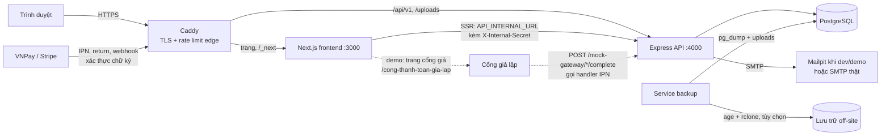

- Production chỉ Caddy publish cổng ra ngoài. Caddy định tuyến `/api/v1/*` và `/uploads/*` thẳng tới backend, phần còn lại tới Next.js.
- Server Components của Next.js gọi backend qua mạng Docker nội bộ (`API_INTERNAL_URL`) cho dữ liệu công khai, kèm `X-Internal-Secret` để không bị tính chung vào rate limit của backend. Rate limit cho lưu lượng SSR do Caddy đảm nhiệm.
- Ở dev, trình duyệt gọi `/api/v1/*` qua `rewrites` của Next.js tới `localhost:4000`, nên cookie vẫn first-party.
- Demo một lệnh không có Caddy: trình duyệt vào thẳng frontend (cổng 3300), frontend gọi backend qua mạng nội bộ, cổng thanh toán giả và Mailpit thay cho nhà cung cấp thật.
- Sơ đồ đã thu gọn: callback thanh toán đi qua Caddy tới API. Chi tiết: [docs/architecture.md](docs/architecture.md); luồng thanh toán giả và đăng nhập 2 bước: [docs/overview.md](docs/overview.md#sơ-đồ-luồng).

## Stack

| Thành phần        | Công nghệ                                                                           | Phiên bản (theo `package.json`) |
| ----------------- | ----------------------------------------------------------------------------------- | ------------------------------- |
| Runtime           | Node.js                                                                             | >= 22                           |
| Frontend          | Next.js (App Router), React                                                         | `^16.4`, `^19.3`                |
| Styling           | Tailwind CSS                                                                        | `^4.3`                          |
| Ngôn ngữ          | TypeScript                                                                          | backend `~5.9`, frontend `^6.0` |
| Backend           | Express                                                                             | `^4.22`                         |
| Validate          | Zod                                                                                 | `^4.6`                          |
| ORM               | Prisma (driver adapter `pg`)                                                        | `~7.10`                         |
| Database          | PostgreSQL                                                                          | 17 (image Docker)               |
| Auth              | argon2 (argon2id), jose (JWT); TOTP tự cài                                          | `^0.45`, `^6.2`                 |
| Email, QR         | nodemailer, qrcode                                                                  | `^10.6`, `^1.5`                 |
| Log, bảo mật HTTP | pino, helmet, express-rate-limit                                                    | `^10.4`, `^8.3`, `^8.7`         |
| Test              | Vitest + supertest (backend), Vitest + Testing Library (frontend), Playwright (E2E) | `^5.1`, `^5.1`, `^1.65`         |
| Hạ tầng           | Docker Compose, Caddy, GitHub Actions                                               |                                 |

## Chạy từng phần để phát triển

Yêu cầu: Node.js >= 22 với npm, Docker và Docker Compose.

```bash
# 1. Hạ tầng: PostgreSQL (127.0.0.1:5432, tự tạo thêm DB beanbox_test)
#    và Mailpit (SMTP 1025, giao diện http://localhost:8025)
docker compose up -d db mailpit

# 2. Backend
cd backend
cp .env.example .env          # PowerShell: Copy-Item .env.example .env
npm install
npm run prisma:generate       # Prisma 7 bắt buộc (D-036): sinh client vào src/generated, không commit
npm run prisma:deploy         # áp migration (hoặc npm run prisma:migrate khi phát triển schema)
npm run prisma:seed           # tài khoản, danh mục, sản phẩm, cài đặt, mã giảm giá mẫu
npm run dev                   # http://localhost:4000/api/v1/health

# 3. Frontend (terminal khác)
cd frontend
cp .env.example .env.local    # PowerShell: Copy-Item .env.example .env.local
npm install
npm run dev                   # http://localhost:3000
```

Phải chạy lại `npm run prisma:generate` sau mỗi lần `npm install`/`npm ci` hoặc khi sửa `schema.prisma`.

Tùy chọn: chạy cả backend và frontend trong Docker bằng profile `app`. Cần `JWT_ACCESS_SECRET` và `INTERNAL_API_SECRET` (mỗi biến >= 32 ký tự, tự đặt) trong `.env` ở thư mục gốc hoặc môi trường shell.

```bash
docker compose --profile app up -d --build
# Frontend http://localhost:3000, backend http://localhost:4000/api/v1/health
```

Tài khoản từ seed: `admin@beanbox.local` (Admin), `staff@beanbox.local` (Staff), `customer@beanbox.local` (Khách hàng). Mật khẩu lấy từ các biến `SEED_ADMIN_PASSWORD`, `SEED_STAFF_PASSWORD`, `SEED_CUSTOMER_PASSWORD` trong `backend/.env` (giá trị dev mặc định nằm trong [backend/.env.example](backend/.env.example), chỉ dùng cho môi trường dev). Seed từ chối chạy khi `NODE_ENV=production`, trừ khi đặt `SEED_ALLOW_PRODUCTION=true` có chủ ý (xem [docs/deployment.md](docs/deployment.md)).

Reset DB dev (xóa sạch dữ liệu, migrate lại và seed lại): `npm run db:reset` trong `backend/`. Cổng thanh toán giả và chuyển khoản demo ở môi trường dev bật bằng `PAYMENT_MOCKS_ENABLED=true`, `BANK_TRANSFER_ENABLED=true` và `TOTP_ENCRYPTION_KEY` trong `backend/.env` (mẫu trong `.env.example`).

## Kiểm thử và CI

```bash
# Backend (cần Postgres đang chạy; test dùng DB riêng beanbox_test, tự áp migration)
cd backend
npm run lint && npm run typecheck && npm test && npm run build

# Frontend
cd frontend
npm run lint && npm run typecheck && npm test && npm run build

# E2E (Playwright, chromium)
cd frontend
npx playwright install chromium    # một lần
npm run test:e2e
```

- Test backend gồm unit (tính giá, phí ship, máy trạng thái, TOTP theo vector RFC...) và integration bằng supertest trên Postgres thật, trong đó có ma trận phân quyền tự động cho các route (`backend/tests/securityAuthz.integration.test.ts`).
- Nếu volume Postgres có từ trước nên chưa có DB `beanbox_test`: `docker compose exec db psql -U beanbox -c "CREATE DATABASE beanbox_test"`.
- E2E cần Postgres đã migrate và seed, và `backend/.env` có các biến `SEED_*` (config tự đọc mật khẩu từ đó). Playwright tự khởi động backend và frontend. Lưu ý giới hạn đăng nhập 5 lần/phút/IP khi chạy lặp liên tiếp. Chi tiết: [docs/testing.md](docs/testing.md).

Workflow `.github/workflows/ci.yml` chạy khi push lên `main` và trên pull request:

| Job           | Nội dung                                                                                                                                                    |
| ------------- | ----------------------------------------------------------------------------------------------------------------------------------------------------------- |
| `backend`     | Postgres service, `prisma migrate deploy` trên DB trống, kiểm drift migration, lint, `format:check`, typecheck, test kèm coverage (có ngưỡng), build        |
| `frontend`    | lint, `format:check`, typecheck, test kèm coverage (có ngưỡng), build                                                                                       |
| `e2e`         | Playwright (chromium) với Postgres + Mailpit, bật cổng thanh toán giả và chuyển khoản demo, seed bằng mật khẩu giả của CI; chạy sau `backend` và `frontend` |
| `secret-scan` | gitleaks (Docker, ghim phiên bản) quét toàn bộ lịch sử git                                                                                                  |
| `audit`       | `npm audit` cả hai phía, chỉ báo cáo, không làm fail                                                                                                        |
| `docker`      | Build image backend, frontend, Caddy; build image backup và chạy selftest backup off-site (không push); Trivy quét image, chỉ báo cáo (D-067)               |
| `ops-lint`    | `shellcheck` cho script trong `deploy/`, `docker compose config` cho các file compose (production và demo)                                                  |

Mọi `uses:` trong workflow được ghim vào full commit SHA kèm comment phiên bản ([D-067](docs/decisions.md#d-067-ci-supply-chain-ghim-sha-actions-và-trivy-chỉ-báo-cáo)). Báo cáo coverage html được lưu ở artifact của job (7 ngày). Dependabot (`.github/dependabot.yml`) mở PR cập nhật hằng tuần cho npm, Docker và GitHub Actions, gộp minor/patch ([D-055](docs/decisions.md#d-055-ci-coverage-kiểm-định-dạng-và-dependabot)). Không có deploy tự động.

## Cấu trúc thư mục

```
BeanBox/
├─ backend/                 Express API
│  ├─ src/                  config, lib, middlewares, modules/<module>, jobs
│  ├─ prisma/               schema.prisma, migrations, seed
│  ├─ prisma.config.ts      cấu hình Prisma CLI (Prisma 7)
│  ├─ scripts/              generate-demo-orders.ts (đơn demo), demo-init.sh (khởi tạo demo một lệnh)
│  └─ tests/                unit + integration
├─ frontend/                Next.js (App Router)
│  ├─ src/app/              route (/san-pham, /gio-hang, /admin ...)
│  ├─ src/components/       UI dùng chung
│  ├─ src/features/         theo nghiệp vụ (orders, payments, account, admin ...)
│  ├─ e2e/                  Playwright
│  └─ scripts/screenshots/  script chụp ảnh cho README (không chạy trong CI)
├─ deploy/
│  ├─ caddy/                Caddyfile, Dockerfile (plugin rate limit)
│  ├─ backup/               backup, restore, off-site, selftest
│  └─ monitoring/           check.sh
├─ docker/db-init/          khởi tạo DB test cho docker compose
├─ docs/                    tài liệu thiết kế, kiểm thử, triển khai; screenshots/
├─ docker-compose.demo.yml  demo một lệnh: db, init, backend, frontend, mailpit riêng
├─ docker-compose.yml       dev: db, mailpit; profile app
├─ docker-compose.prod.yml  production/demo VPS: caddy, frontend, backend, db; profile backup, tools
├─ .env.production.example  mẫu biến môi trường production
└─ .github/workflows/ci.yml
```

## Triển khai

Dự án này là portfolio chạy localhost, không có bản demo công khai. Nếu muốn chạy trên một VPS, `docker-compose.prod.yml` dựng Caddy làm reverse proxy với HTTPS tự động, chỉ Caddy publish cổng; backend, frontend, PostgreSQL nằm trong mạng Docker nội bộ. Biến môi trường lấy từ `.env.production` (mẫu: `.env.production.example`). Hướng dẫn VPS, DNS, thanh toán sandbox, backup/restore, rollback và checklist go-live: [docs/deployment.md](docs/deployment.md).

## Tài liệu

- [Tổng quan quyết định kỹ thuật và sơ đồ luồng](docs/overview.md) (đọc đầu tiên)
- [Yêu cầu](docs/requirements.md)
- [Kiến trúc](docs/architecture.md)
- [Nhật ký quyết định](docs/decisions.md)
- [API contract](docs/api-contract.md) (nguồn sự thật cho FE và BE)
- [Thiết kế DB](docs/db-schema.md)
- [Kế hoạch khu Phân tích kinh doanh (Admin)](docs/admin-dashboard-plan.md)
- [Kiểm thử](docs/testing.md)
- [Triển khai](docs/deployment.md)
- [Cấu hình thanh toán sandbox](docs/payments-setup.md)
- [Hướng dẫn chụp lại ảnh màn hình](docs/screenshots/README.md)
- Kế hoạch theo đợt: [Đợt 2](docs/wave2-plan.md), [Đợt 3](docs/wave3-plan.md); [lộ trình tiếp theo](docs/roadmap-next.md)
