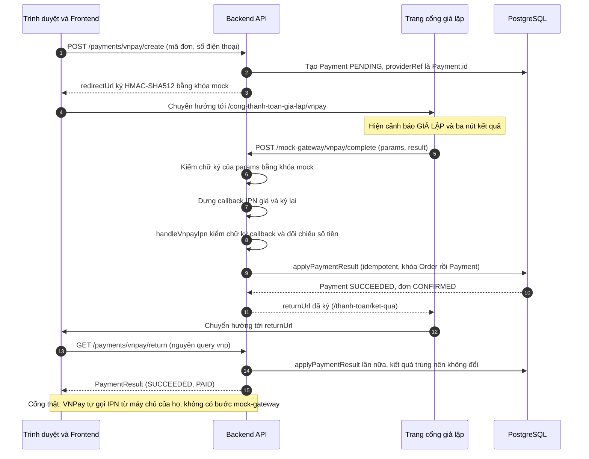
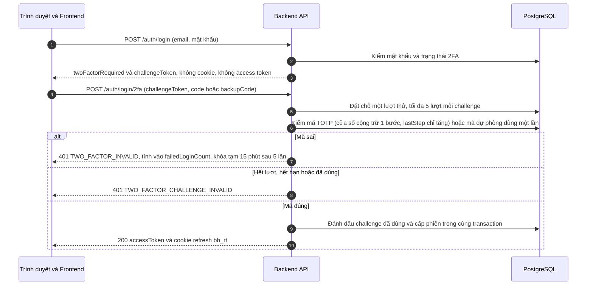

# BeanBox – Tổng quan cho người đọc nhanh

> Trang này dành cho người muốn nắm nhanh dự án trong vài phút (ví dụ người phỏng vấn). Chi tiết từng quyết định ở [decisions.md](decisions.md); cách chạy demo ở [README](../README.md).

BeanBox là web thương mại điện tử bán hạt cà phê, dụng cụ pha chế và phụ kiện (giao diện tiếng Việt, tiền VND). Dự án gồm storefront Next.js, REST API Express + Prisma + PostgreSQL và khu quản trị có phân tích kinh doanh. Dự án chạy trên localhost: thanh toán (VNPay giả, MoMo giả, chuyển khoản VietQR demo) và vận chuyển (mã vận đơn, hành trình) đều là giả lập, nhưng được viết để đi qua đúng logic như khi nối nhà cung cấp thật: giá tính ở server, đặt đơn idempotent, giữ tồn kho trong transaction, callback thanh toán có chữ ký, phiên đăng nhập với refresh token xoay vòng và xác thực 2 lớp. Có 83 quyết định kỹ thuật (D-001 đến D-083) được ghi lại cùng đánh đổi. **Trạng thái dự án: đã hoàn thiện và đóng roadmap (2026-11-23); chỉ bảo trì** (sửa lỗi, cập nhật phụ thuộc), xem [roadmap-next.md](roadmap-next.md).

## Quyết định theo chủ đề

Mỗi dòng trỏ tới mục tương ứng trong [decisions.md](decisions.md). Phần cuối liệt kê các quyết định còn lại để bảng phủ đủ D-001 đến D-083.

### Bảo mật và phiên đăng nhập

| Quyết định                                                                                                                      | Tóm tắt                                                                                                                                     |
| ------------------------------------------------------------------------------------------------------------------------------- | ------------------------------------------------------------------------------------------------------------------------------------------- |
| [D-009](decisions.md#d-009-xác-định-ip-client-cho-rate-limit)                                                                   | Xác định IP client sau proxy để rate limit đúng, không tin header tùy tiện.                                                                 |
| [D-026](decisions.md#d-026-reverse-proxy-caddy-và-rate-limit-ở-edge), [D-027](decisions.md#d-027-rate-limit-khi-nhiều-instance) | Rate limit hai tầng (Caddy ở edge, `express-rate-limit` ở app); bộ đếm trong bộ nhớ nên chỉ phù hợp một instance.                           |
| [D-032](decisions.md#d-032-csp-ở-m7), [D-040](decisions.md#d-040-csp-ở-m8)                                                      | CSP được thực thi: nonce và `strict-dynamic` cho `/admin`, storefront giữ `unsafe-inline` để còn static/ISR.                                |
| [D-045](decisions.md#d-045-rà-soát-bảo-mật-sau-m8)                                                                              | Refresh token xoay vòng, phát hiện dùng lại thì thu hồi cả chuỗi; access token gắn với phiên nên bị chặn ngay khi đăng xuất hoặc đổi quyền. |
| [D-063](decisions.md#d-063-xác-thực-2-lớp-totp-cho-staff-và-admin)                                                              | TOTP RFC 6238 tự cài, secret mã hóa AES-GCM, chống dùng lại bằng `lastStep`, mã dự phòng dùng một lần, đăng nhập 2 bước.                    |
| [D-070](decisions.md#d-070-bắt-buộc-2fa-cho-admin-bằng-cờ-require_admin_2fa)                                                    | Cờ `REQUIRE_ADMIN_2FA` (mặc định tắt) bắt buộc Admin bật 2FA trước khi vào `/admin`.                                                        |
| [D-022](decisions.md#d-022-quản-lý-người-dùng)                                                                                  | Quản lý người dùng: không để mất ADMIN cuối cùng, khóa chéo hai Admin được chặn bằng `FOR UPDATE`.                                          |

### Tiền, đơn hàng và tồn kho

| Quyết định                                                                                                                    | Tóm tắt                                                                                                              |
| ----------------------------------------------------------------------------------------------------------------------------- | -------------------------------------------------------------------------------------------------------------------- |
| [D-003](decisions.md#d-003-phụ-phí-khối-lượng-và-freeship)                                                                    | Tiền là `Int` VND; phí ship, phụ phí khối lượng và freeship luôn tính ở server.                                      |
| [D-004](decisions.md#d-004-giữ-lượt-mã-giảm-giá-khi-tạo-đơn)                                                                  | Giữ lượt mã giảm giá lúc tạo đơn bằng UPDATE có điều kiện, hoàn lại khi hủy.                                         |
| [D-010](decisions.md#d-010-quy-tắc-nghiệp-vụ-checkout-m3), [D-011](decisions.md#d-011-rate-limit-cho-mã-giảm-giá-và-đặt-đơn)  | Idempotency-Key gắn người gọi (409 khi khác payload), rate limit riêng cho đặt đơn và áp mã.                         |
| [D-001](decisions.md#d-001-thanh-toán-online-thất-bại), [D-002](decisions.md#d-002-giao-lại-và-khách-hủy-đơn-pending_payment) | Thanh toán online thất bại thì đơn vẫn chờ tới hạn để thử lại; quy tắc giao lại và khách hủy đơn chờ thanh toán.     |
| [D-013](decisions.md#d-013-quy-tắc-nghiệp-vụ-admin-m4)                                                                        | Máy trạng thái đơn và quy tắc nghiệp vụ khu Admin.                                                                   |
| [D-057](decisions.md#d-057-chống-giữ-kho-bằng-đơn-cod-khách-vãng-lai)                                                         | Chống giữ kho bằng nhiều đơn COD của khách vãng lai: giới hạn đơn mở, hạn xác nhận, khóa advisory theo SĐT và email. |
| [D-068](decisions.md#d-068-mã-vận-đơn-duy-nhất-ở-db)                                                                          | Mã vận đơn duy nhất ở DB (unique index), bắt P2002 trả 409 và thử lại khi sinh mã giả.                               |
| [D-071](decisions.md#d-071-ghi-chú-nội-bộ-trên-đơn-hàng), [D-072](decisions.md#d-072-in-phiếu-giao-hàng-loạt), [D-073](decisions.md#d-073-xuất-và-nhập-csv-sản-phẩm) | Ghi chú nội bộ trên đơn (append-only), in phiếu giao hàng loạt (tối đa 50), xuất/nhập CSV sản phẩm 2 bước. |
| [D-075](decisions.md#d-075-cache-http-cho-catalog-ảnh-và-cài-đặt), [D-076](decisions.md#d-076-khóa-tạm-theo-mã-đơn-cho-khách-vãng-lai), [D-077](decisions.md#d-077-mua-lại) | Cache HTTP ngắn cho catalog và ảnh bất biến, khóa tạm theo mã đơn (5 lần sai -> 15 phút) cho khách vãng lai, "Mua lại" đơn cũ vào giỏ. |
| [D-079](decisions.md#d-079-tắt-êm-và-lỗi-tiến-trình), [D-080](decisions.md#d-080-làm-mới-minprice-theo-mốc-sale), [D-081](decisions.md#d-081-allowlist-ảnh-đại-diện), [D-082](decisions.md#d-082-độ-tươi-hạt-cà-phê) | Tắt êm khi nhận tín hiệu/lỗi tiến trình (chờ job, đóng DB, exit code đúng), job làm mới giá theo mốc sale, ảnh đại diện chỉ nhận `/uploads` hoặc host https cho phép, độ tươi hạt (cảnh báo 30 ngày, ngừng bán 90 ngày). |
| [D-074](decisions.md#d-074-tách-file-lớn-và-hộp-thoại-dùng-chung) | Tách file lớn (cài đặt, checkout) và hộp thoại dùng chung dựa trên `<dialog>` native: inert nền, focus trap, trả focus. |
| [D-078](decisions.md#d-078-giá-vốn-bình-quân-gia-quyền-di-động-và-lợi-nhuận-gộp) | Giá vốn bình quân gia quyền di động theo biến thể (nhập hàng kèm đơn giá), chụp vào dòng đơn lúc đặt, lợi nhuận gộp hàng hóa ở phân tích (chỉ Admin; đơn cũ chưa có giá vốn, không đoán). |

### Thanh toán

| Quyết định                                                                                                      | Tóm tắt                                                                                                                                   |
| --------------------------------------------------------------------------------------------------------------- | ----------------------------------------------------------------------------------------------------------------------------------------- |
| [D-014](decisions.md#d-014-thanh-toán-online-m5), [D-015](decisions.md#d-015-hoàn-tiền-thủ-công-và-job-hết-hạn) | VNPay sandbox và Stripe test mode, chỉ dữ liệu có chữ ký mới đổi trạng thái; một hàm xử lý idempotent; hoàn tiền thủ công và job hết hạn. |
| [D-060](decisions.md#d-060-thanh-toán-giả-lập-cho-demo-vnpay-giả-momo-giả)                                      | VNPay giả và MoMo giả đi qua đúng handler IPN có chữ ký; chỉ bật được ở dev, bị từ chối ở production.                                     |
| [D-061](decisions.md#d-061-chuyển-khoản--vietqr-demo)                                                           | Chuyển khoản VietQR demo: QR EMVCo dựng ở server, "Tôi đã chuyển khoản" chỉ ghi nhận, nhân viên xác nhận mới tính là đã thanh toán.       |

### Vận chuyển

| Quyết định                                                                                               | Tóm tắt                                                                                                                        |
| -------------------------------------------------------------------------------------------------------- | ------------------------------------------------------------------------------------------------------------------------------ |
| [D-062](decisions.md#d-062-vận-chuyển-giả-lập-thời-gian-giao-dự-kiến-mã-vận-đơn-giả-hành-trình-mô-phỏng) | Giao hàng giả lập: ngày giao dự kiến theo settings, mã vận đơn giả, hành trình mô phỏng tính từ lịch sử đơn (không thêm bảng). |
| [D-006](decisions.md#d-006-vùng-ship-nội-thành-và-dữ-liệu-hành-chính)                                    | Vùng ship nội thành và dữ liệu hành chính 2 cấp.                                                                               |

### Dữ liệu cá nhân

| Quyết định                                                                                                                 | Tóm tắt                                                                                     |
| -------------------------------------------------------------------------------------------------------------------------- | ------------------------------------------------------------------------------------------- |
| [D-065](decisions.md#d-065-quyền-dữ-liệu-cá-nhân-khách-tự-xóa-ẩn-danh-hóa-tài-khoản-và-xuất-dữ-liệu)                       | Khách tự xóa tài khoản bằng ẩn danh hóa (giữ đơn và analytics) và tải bản sao dữ liệu JSON. |
| [D-007](decisions.md#d-007-chuẩn-hóa-số-điện-thoại), [D-008](decisions.md#d-008-sổ-địa-chỉ-khi-chưa-có-dữ-liệu-hành-chính) | Chuẩn hóa số điện thoại; sổ địa chỉ khi chưa có dữ liệu hành chính.                         |
| [D-029](decisions.md#d-029-thời-hạn-lưu-tin-nhắn-liên-hệ)                                                                  | Thời hạn lưu tin nhắn liên hệ.                                                              |
| [D-005](decisions.md#d-005-khách-vãng-lai-xem-đơn-qua-trang-tra-cứu)                                                       | Khách vãng lai xem đơn qua mã đơn và số điện thoại, không lộ PII.                           |

### Analytics và hiệu năng

| Quyết định                                                                                                                                                                            | Tóm tắt                                                                                                          |
| ------------------------------------------------------------------------------------------------------------------------------------------------------------------------------------- | ---------------------------------------------------------------------------------------------------------------- |
| [D-049](decisions.md#d-049-khu-phân-tích-kinh-doanh-chỉ-admin), [D-050](decisions.md#d-050-khoảng-ngày-kỳ-so-sánh-và-gom-nhóm-của-phân-tích-kinh-doanh)                               | Khu phân tích chỉ Admin (hai lớp phân quyền), khoảng ngày và kỳ so sánh.                                         |
| [D-051](decisions.md#d-051-cơ-cấu-doanh-thu-top-sản-phẩm-top-khách-hàng-bước-2), [D-052](decisions.md#d-052-khách-hàng-vận-hành-tồn-kho-bước-3)                                       | Cơ cấu doanh thu, top sản phẩm/khách, khách hàng, vận hành, tồn kho.                                             |
| [D-053](decisions.md#d-053-hiệu-quả-mã-giảm-giá-và-xuất-csv-bước-4)                                                                                                                   | Hiệu quả mã giảm giá và xuất CSV: chống CSV injection, audit, rate limit.                                        |
| [D-054](decisions.md#d-054-hiệu-năng-a11y-và-bản-in-khu-phân-tích-bước-5-phần-a), [D-058](decisions.md#d-058-bảo-vệ-db-khỏi-truy-vấn-analytics-nặng-và-giới-hạn-tài-nguyên-container) | Đo trên 100.000 đơn Postgres 17; pool riêng và `statement_timeout` cho analytics, giới hạn tài nguyên container. |
| [D-019](decisions.md#d-019-dashboard-và-audit-log)                                                                                                                                    | Dashboard và nhật ký thao tác (audit log).                                                                       |

### Frontend, SEO và a11y

| Quyết định                                                                                                                                                             | Tóm tắt                                                                                                    |
| ---------------------------------------------------------------------------------------------------------------------------------------------------------------------- | ---------------------------------------------------------------------------------------------------------- |
| [D-044](decisions.md#d-044-khả-năng-truy-cập-và-lighthouse)                                                                                                            | Khả năng truy cập (axe, Lighthouse) cho storefront.                                                        |
| [D-046](decisions.md#d-046-gợi-ý-sản-phẩm-liên-quan-và-mua-cùng), [D-047](decisions.md#d-047-so-sánh-sản-phẩm)                                                         | Gợi ý sản phẩm liên quan, mua cùng (ngưỡng riêng tư) và so sánh sản phẩm.                                  |
| [D-048](decisions.md#d-048-kiểm-tra-giao-diện-admin-trên-mobile-390-và-768)                                                                                            | Kiểm tra giao diện `/admin` trên mobile (390 và 768).                                                      |
| [D-059](decisions.md#d-059-lớp-lỗi-trạng-thái-tải-header-mobile-và-múi-giờ-hiển-thị)                                                                                   | Lớp lỗi, trạng thái tải, header mobile và múi giờ hiển thị.                                                |
| [D-064](decisions.md#d-064-seo-kỹ-thuật-trang-chủ-isr-ảnh-og-sitemap-lastmod-canonicalnoindex-json-ld), [D-069](decisions.md#d-069-robotstxt-không-chặn-trang-noindex) | Trang chủ ISR, ảnh OG, sitemap `lastmod`, canonical/noindex, JSON-LD; robots.txt không chặn trang noindex. |
| [D-018](decisions.md#d-018-redirect-slug-và-khôi-phục-sản-phẩm)                                                                                                        | Redirect slug (308) khi đổi tên sản phẩm và khôi phục sản phẩm xóa mềm.                                    |

### Vận hành và CI

| Quyết định                                                                                                                                         | Tóm tắt                                                                         |
| -------------------------------------------------------------------------------------------------------------------------------------------------- | ------------------------------------------------------------------------------- |
| [D-033](decisions.md#d-033-ci-github-actions), [D-055](decisions.md#d-055-ci-coverage-kiểm-định-dạng-và-dependabot)                                | CI GitHub Actions; coverage có ngưỡng, kiểm định dạng, Dependabot.              |
| [D-067](decisions.md#d-067-ci-supply-chain-ghim-sha-actions-và-trivy-chỉ-báo-cáo)                                                                  | Ghim SHA cho Actions; Trivy chỉ báo cáo.                                        |
| [D-034](decisions.md#d-034-backup-và-khôi-phục), [D-038](decisions.md#d-038-backup-off-site), [D-043](decisions.md#d-043-selftest-backup-trong-ci) | Backup và khôi phục, off-site mã hóa age, selftest trong CI.                    |
| [D-026](decisions.md#d-026-reverse-proxy-caddy-và-rate-limit-ở-edge), [D-039](decisions.md#d-039-giám-sát-uptime)                                  | Caddy làm reverse proxy; giám sát uptime bằng script.                           |
| [D-036](decisions.md#d-036-nâng-prisma-7), [D-037](decisions.md#d-037-kiểm-env-trước-migrate-và-redirect-cổng-caddy)                               | Prisma 7; kiểm env bằng Zod trước khi migrate.                                  |
| [D-056](decisions.md#d-056-mailer-bền-vững)                                                                                                        | Mailer bền vững: thử lại, không chặn đặt hàng, log không chứa email người nhận. |
| [D-066](decisions.md#d-066-demo-chạy-bằng-một-lệnh-docker-composedemoyml)                                                                          | Demo chạy bằng một lệnh (`docker-compose.demo.yml`).                            |
| [D-083](decisions.md#d-083-e2e-mobile-390-px-smoke-webkit-warm-up-khởi-động-nguội-đo-tải-đặt-hàng-đồng-thời) | E2E luồng mua ở 390 px và smoke WebKit, warm-up khởi động nguội, đo tải đặt hàng đồng thời cùng SKU (không oversell, không deadlock). |

### Các quyết định còn lại

Không xếp vào chủ đề trên; xem đầy đủ ở [docs/decisions.md](decisions.md).

| Quyết định                                                                         | Tiêu đề                                                  |
| ---------------------------------------------------------------------------------- | -------------------------------------------------------- |
| [D-012](decisions.md#d-012-nội-dung-trang-chính-sách-và-điều-khoản-mua-hàng)       | Nội dung trang chính sách và điều khoản mua hàng         |
| [D-016](decisions.md#d-016-chốt-3-câu-hỏi-sau-m4)                                  | Chốt 3 câu hỏi sau M4                                    |
| [D-017](decisions.md#d-017-đánh-giá-sản-phẩm)                                      | Đánh giá sản phẩm                                        |
| [D-020](decisions.md#d-020-phạm-vi-m6-e2e-và-audit-bảo-mật)                        | Phạm vi M6, E2E và audit bảo mật                         |
| [D-021](decisions.md#d-021-cài-đặt-cửa-hàng)                                       | Cài đặt cửa hàng                                         |
| [D-023](decisions.md#d-023-form-liên-hệ)                                           | Form liên hệ                                             |
| [D-024](decisions.md#d-024-csp-report-only)                                        | CSP report-only                                          |
| [D-025](decisions.md#d-025-mô-hình-triển-khai-demo)                                | Mô hình triển khai demo                                  |
| [D-028](decisions.md#d-028-captcha-tùy-chọn-cho-form-liên-hệ-cloudflare-turnstile) | Captcha tùy chọn cho form liên hệ (Cloudflare Turnstile) |
| [D-030](decisions.md#d-030-health-và-quan-sát-tối-thiểu)                           | Health và quan sát tối thiểu                             |
| [D-031](decisions.md#d-031-seed-dữ-liệu-demo-trên-production-opt-in)               | Seed dữ liệu demo trên production (opt-in)               |
| [D-035](decisions.md#d-035-sửa-hai-rủi-ro-tồn-đọng-trước-deploy)                   | Sửa hai rủi ro tồn đọng trước deploy                     |
| [D-041](decisions.md#d-041-ghim-rclone-trong-image-backup)                         | Ghim rclone trong image backup                           |
| [D-042](decisions.md#d-042-khóa-chống-hai-backup-chạy-chồng)                       | Khóa chống hai backup chạy chồng                         |

## Sơ đồ luồng

Hai sơ đồ dưới đây khớp [api-contract](api-contract.md) §5.2, §5.9, §13.2, §13.3, §13.5 và §13.10.

### Thanh toán VNPay giả lập

Luồng đi qua đúng các hàm của luồng sandbox thật. Khác biệt duy nhất so với cổng thật: ở cổng thật, VNPay gọi IPN (`GET /payments/vnpay/ipn`) từ máy chủ của họ; ở bản giả lập, endpoint `POST /mock-gateway/vnpay/complete` kiểm chữ ký yêu cầu rồi tự dựng callback IPN giả (ký lại bằng khóa mock) và gọi thẳng cùng hàm `handleVnpayIpn`. Cổng giả chỉ tồn tại khi `PAYMENT_MOCKS_ENABLED=true` và bị từ chối khi `NODE_ENV=production`.

### Đăng nhập 2 bước

Đúng mật khẩu nhưng đã bật 2FA thì chưa có phiên nào được cấp: backend chỉ trả `challengeToken` (32 byte ngẫu nhiên, DB lưu SHA-256, sống 5 phút). Phiên (cookie refresh `bb_rt` và access token) chỉ được cấp sau khi mã đúng.

## Đọc tiếp

- [README](../README.md): chạy demo một lệnh, kịch bản demo 5 phút, tour tính năng có ảnh.
- [architecture.md](architecture.md): kiến trúc, xác thực, giá và đơn hàng, thanh toán.
- [api-contract.md](api-contract.md) và [db-schema.md](db-schema.md): nguồn sự thật cho API và DB.
- [testing.md](testing.md): kết quả kiểm thử, đo hiệu năng 100.000 đơn.
- [wave2-plan.md](wave2-plan.md), [wave3-plan.md](wave3-plan.md), [roadmap-next.md](roadmap-next.md): kế hoạch theo đợt và việc còn lại.
